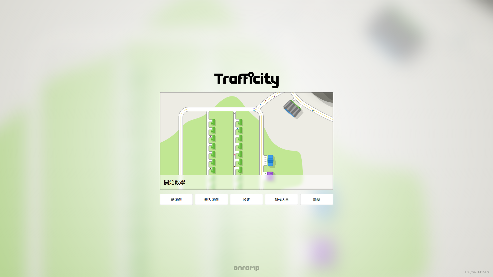

# Trafficity 繁體中文（台灣）漢化

> 為 Steam 版 **Trafficity**（AppID `5185750`）新增獨立「繁體中文」介面語言的社群漢化補丁。



| 項目 | 內容 |
| --- | --- |
| 譯文字串 | 442 條（選單／教學／工具列／建築／行程分析／成就說明／製作人員） |
| 遊戲版本 | 1.0（build 6969441617 實機驗證通過） |
| 補丁大小 | 可攜包約 14 KB；單檔安裝器約 40 KB（皆不含遊戲本體） |
| 依賴 | 無。PowerShell 5.1 內建即可執行 |
| 影響範圍 | 僅介面文字。存檔、成就、多人、Steam 雲端皆不受影響 |

## 這是什麼

遊戲官方只提供簡體中文。本專案**不覆蓋**簡體中文，而是在遊戲的 i18n 資料裡**新增一個 zht 語系**，並將它註冊進語言選單，因此玩家可以在 設定 → 語言 自由切換：

- 繁體中文（新增）
- 简体中文（原始，保留）
- English / Deutsch / Español / Русский / Português (Brasil) / 日本語 / 한국어

當系統或 Steam 語言是 zh-TW、zh-HK、zh-MO、zh-Hant 時，遊戲會自動選到繁體中文。

## 安裝

### 方法一：一鍵安裝 exe（最推薦）

1. 完全關閉遊戲（含 Steam 工作列圖示）。
2. 下載 Release 的 `Trafficity-CHT-Setup.exe`。
3. 雙擊執行。會跳 SmartScreen 警告：**更多資訊 → 仍要執行**。
4. 程式會自動：尋找遊戲目錄 → 備份 `app.asar.orig` → 注入繁中語系 → 重建封裝 → 把語言設為繁中。
5. 啟動遊戲。若語言不是繁中，到 **設定 → 語言 → 繁體中文**。

單檔執行，不需要解壓、不需要安裝任何東西（腳本與譯文都內嵌在 exe 裡）。

找不到遊戲或想指定路徑時：

```
Trafficity-CHT-Setup.exe "D:\SteamLibrary\steamapps\common\Trafficity"
```

### 方法二：可攜腳本包（zip）

1. 完全關閉遊戲（含 Steam 工作列圖示）。
2. 下載並解壓 `Trafficity-CHT-vX.Y.zip`。
3. 對 **`安裝繁體中文.bat`** 點兩下。
   - 出現 SmartScreen 警告：**更多資訊 → 仍要執行**。
   - 跳出 UAC：選「是」（僅用於讀寫遊戲資料夾）。
4. 腳本會自動：尋找遊戲目錄 → 備份 `app.asar.orig` → 注入繁中語系 → 重建封裝 → 把語言設為繁中。
5. 啟動遊戲。若語言不是繁中，到 **設定 → 語言 → 繁體中文**。

找不到遊戲目錄時，把補丁資料夾整個複製到遊戲根目錄再執行，例如：

```
D:\SteamLibrary\steamapps\common\Trafficity\Trafficity-CHT\
```

解壓後若中文檔名變亂碼（舊版 Windows），可直接執行資料夾內的腳本：

```powershell
powershell -NoProfile -ExecutionPolicy Bypass -File patch.ps1
```

### 方法三：手動替換

1. 備份 `resources\app.asar`。
2. 下載 release 附帶的完整 `app.asar`。
3. 覆蓋 `resources\app.asar`。
4. 進遊戲切換語言。

## 還原

- 執行 **`Trafficity-CHT-Setup.exe --restore`**，或可攜包內的 **`還原原版.bat`**。
- 兩者都會把 `resources\app.asar.orig` 還原回 `app.asar`。
- 或在 Steam 對遊戲按 **內容 → 已安裝檔案 → 驗證檔案完整性**。

## 常見問題

**Q：遊戲更新後變回英文？**
A：Steam 更新會覆蓋 `app.asar`。重新執行一次安裝腳本即可。

**Q：腳本說「遊戲版本不相容」？**
A：代表上游改了語言表結構，腳本偵測不到錨點時會**安全中止、不動任何檔案**。請開 issue 附上遊戲版本號。

**Q：成就名稱還是英文？**
A：Steam 成就的顯示名稱存在伺服器端，客戶端無法覆寫。成就**說明**與解鎖通知在遊戲內都是繁中。

**Q：會被防毒擋嗎？**
A：腳本只用 PowerShell 做檔案讀寫，沒有網路連線、沒有加殼、沒有注入行程。少數防毒對 PowerShell 腳本較敏感，可改用手動替換。

**Q：可以搭配其他模組嗎？**
A：只要對方也改 `app.asar` 就會衝突（後裝的覆蓋前者）。若都是文字修改，建議合併到同一份 `zht.json`。

## 運作原理

Trafficity 是 Electron 應用，程式碼全部打包在 `resources\app.asar`（約 653 MB，內容多為音樂與示範存檔）。漢化只動其中一個檔案：`dist/transit-city-game.<hash>.js`。

腳本依序做五件事：

1. **注入語系資料** — 在 `LOCALISATION_STRINGS` 的 `zhs`（簡中）物件後插入 `zht:{...}` 共 442 條譯文。
2. **註冊語言名稱** — 語言對照表加入 `zht:"繁體中文"`。
3. **Steam 語言對應** — `tchinese` / `traditionalchinese` → `zht`。
4. **語系代碼對應** — `zht` → `zh-TW`（給 Intl、日期格式用）。
5. **自動偵測** — 讓 navigator.language 的 zh-TW / zh-HK / zh-MO / zh-Hant 優先選到 zht。

改完後重寫 asar 標頭與所有檔案偏移（`4 | headerSize | payloadSize | jsonLen | json`），其他檔案位元組完全不變。

> asar 完整性校驗（Electron fuse `EnableEmbeddedAsarIntegrityValidation`）在本作中為關閉狀態，因此重建封裝不會被阻擋。

## 版本相容性

腳本在寫入前會檢查所有錨點是否存在，任一缺失就中止且不修改檔案：

```
zhs:{                              → 簡中語系物件
schinese:"zhs"                     → Steam 語言對照
zhs:"zh-CN"                        → 語系代碼
if("zh"===t)return c(n)...         → 語言偵測邏輯
dist/transit-city-game.<hash>.js   → 主程式（檔名含雜湊，動態比對）
```

## 開發

repo 內的 `tools/` 是給開發者用的 Node 工具（不安裝也能玩）：

```bash
# 檢視 asar 結構
node tools/inspect-asar.mjs /path/to/app.asar list

# 由原始 app.asar + src/zht.json 重新產生漢化版封裝
node tools/build-asar.mjs /path/to/app.asar.orig ./app.asar.new
```

`tools/build-asar.mjs` 與 `src/patch.ps1` 產生的檔案**位元組完全相同**（SHA-256 `ca036a04...`），可互相驗證。

### 重新打包 release

```powershell
Compress-Archive -Path src\* -DestinationPath Trafficity-CHT-v1.0.zip -Force
```

或直接執行 `.\build-release.ps1 -Tag v1.0`。

## 貢獻

最需要的是**譯文校對**。請直接改 `src/zht.json`（純 JSON，鍵＝原文字串 id），開 PR 即可，詳見 [CONTRIBUTING.md](CONTRIBUTING.md)。

翻譯時請保留三種標記，否則遊戲內會顯示錯誤：

| 標記 | 範例 | 說明 |
| --- | --- | --- |
| 變數佔位 | `{count}` `{name}` `{level}` `{percent}` `{hhMm}` | 原樣保留，可調整順序 |
| 按鍵提示 | `[key:elevationUp]` | 由遊戲替換成玩家自訂按鍵 |
| 教學強調 | `__toolbar.grid__` | 底線包住的 i18n key，會換成該工具譯名 |

## 授權

- 程式碼（`src/*.ps1`、`tools/*.mjs`、CI）：**MIT**
- 譯文（`src/zht.json`、文件中譯文）：**CC BY-SA 4.0**

本專案**不包含**任何遊戲檔案。使用前請先自行購買 Trafficity。

## 致謝

- [OnRamp Games](https://store.steampowered.com/app/5185750/) — 開發 Trafficity
- 簡體中文譯者 Yehua Jiang — 部分語感參考
- 所有回報錯字與語句不通的玩家

---

## English

Community **Traditional Chinese (Taiwan)** localization patch for **Trafficity** (Steam AppID 5185750).

The game ships Simplified Chinese only. This patch **adds a separate `zht` locale** (442 strings) alongside the existing ones, registers it in the in-game language picker, and maps `zh-TW` / `zh-HK` / `zh-Hant` to it automatically. Nothing else in the app is touched — saves, achievements and Steam Cloud are unaffected.

**Install:** close the game, extract the release zip, run `安裝繁體中文.bat` (double-click), then pick 繁體中文 under Settings → Language. `還原原版.bat` restores the original archive.

**How it works:** the game is an Electron app; everything lives in `resources\app.asar`. The patch surgically edits `dist/transit-city-game.<hash>.js` (five deterministic string patches) and rebuilds the asar header with recomputed offsets. If any anchor is missing the script aborts without touching your files.

Code is MIT-licensed; translations are CC BY-SA 4.0. No game assets are included.
